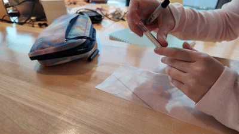
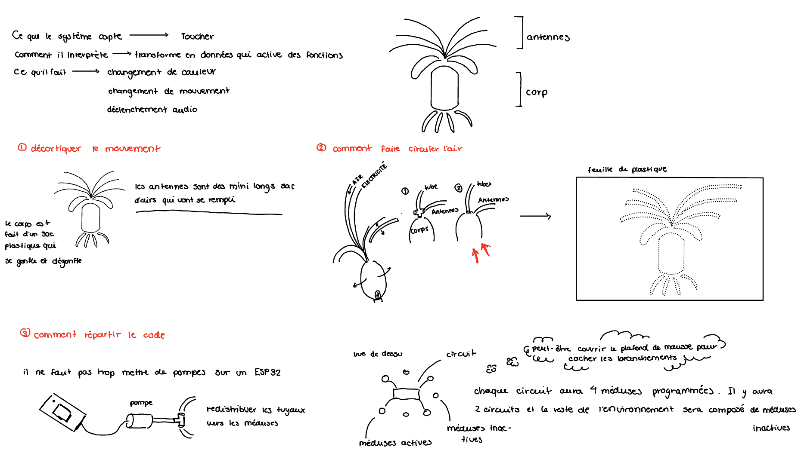

# Journal de documentation
---

## Sommaire

- [Objectifs](#-objectifs)
- [Entrées quotidiennes](#-entrées-quotidiennes)
- [Sources & références](#-sources--références)

---

## Objectifs

**But principal :** *Cette documentation nous permet de visualiser notre processus de prototypage, ainsi permettant l'évolution, l'expérimentation et l'apprentissage de notre projet final.*

**Public cible :**  *Notre projet s'adresse à un public qui sont moins sensibiliser de l'impact des humains sur l'écosystème.*

---

### 11-05 — *Premier prototypage*

#### Ce qui a été fait
- Analyse des mouvements et la façon dont le code et la matière interagissent
- Comprendre comment l'air circulerait dans l'œuvre
- Discussion sur l'accrochage et la disposition des fils
- Visite de la salle et de notre emplacement
- Rencontre avec le technicien pour l'exposition

#### Blocages rencontrés
- Circulation d'air: Puisque nous avons des antennes, nous nous sommes heurtés sur la manière d'assembler celles-ci avec le corps →

  *Au lieu de découper individuellement des antennes et de les reliées au corps comme idéalisé en premier lieu, nous allons prendre des plus grandes feuilles de plastique dans lesquelles nous allons détourer un patron*

#### Notes brutes

>

#### Prochaines étapes
- [ ] Finalisation du moodboard
- [ ] Trouver nos matériaux
- [ ] Avoir des grandes feuilles de plastique
- [ ] Avoir un premier code

📎 Pièces jointes & captures

- Lien vers un document

---

## 📚 Sources & références

| # | Titre | Type  | Lien  |
|---|---|---|---|
| 1 | Inspirations |  Pinterest | [lien](https://pin.it/3Wc1fhkl2) |
| 2 | Article de blog | 📰 Article | [lien](https://example.com) |

---

## 🔄 Journal des modifications

| Date | Version | Auteur | Changement |
|---|---|---|---|
| `2026-11-05` | 0.1.0 | `Jade` | Création du journal |
| `AAAA-MM-JJ` | 0.2.0 | `Nom` | Ajout de la section X |

---

*Dernière modification : `2026-11-12`*

