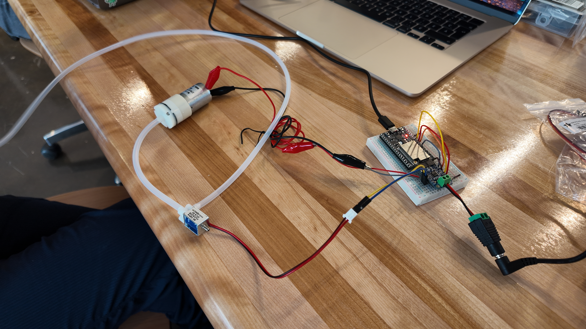

# Semaine 3 - Souplesse / Agentivité matérielle

## Théorie et pratique du cours 
https://ena.etsmtl.ca/mod/folder/view.php?id=2015303

### Description de la séance

[dossier 📁 ](https://drive.google.com/drive/folders/1wpJn0DS9V9a3aNyb-NFZepJDWFuKi_IW?usp=drive_link)

Cette semaine, nous avons parler du passage de la perception à l'action. Ce passage repose  sur la manière dont un objet technique est conçu et interagit avec son environnement. Un objet peut évoluer grâce à l’assemblage et à l’adaptation de ses composantes.

Une même donnée, comme la lumière captée par un capteur, peut produire différentes actions, comme allumer une DEL, faire tourner un moteur ou faire vibrer une surface. Le comportement dépend donc non seulement de la donnée, mais aussi des choix de conception, du contexte et de l’intention.


<b>Lire une œuvre comme un système interactif</b>

PERCEPTION → TRAITEMENT → ACTIONNEMENT

Ce que le système capte → comment il interprète → ce qu'il fait

```text
Capteurs du CP Express → ESP32 → Servo → actionnement d’une surface souple
```

---

## Création du premier mini projet

Utilisation du ESP32, de deux servo, afin qu'ils mettent en mouvement une surface souple


