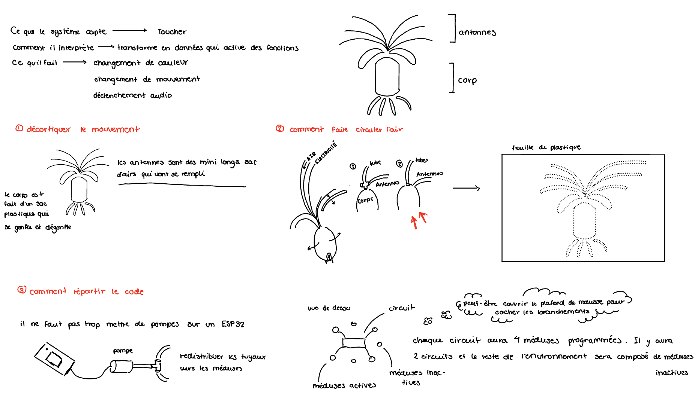
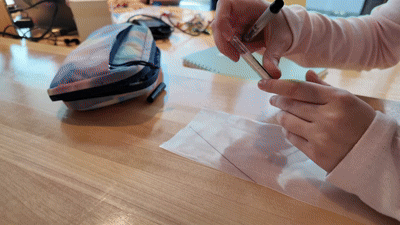
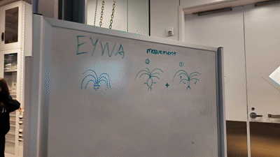
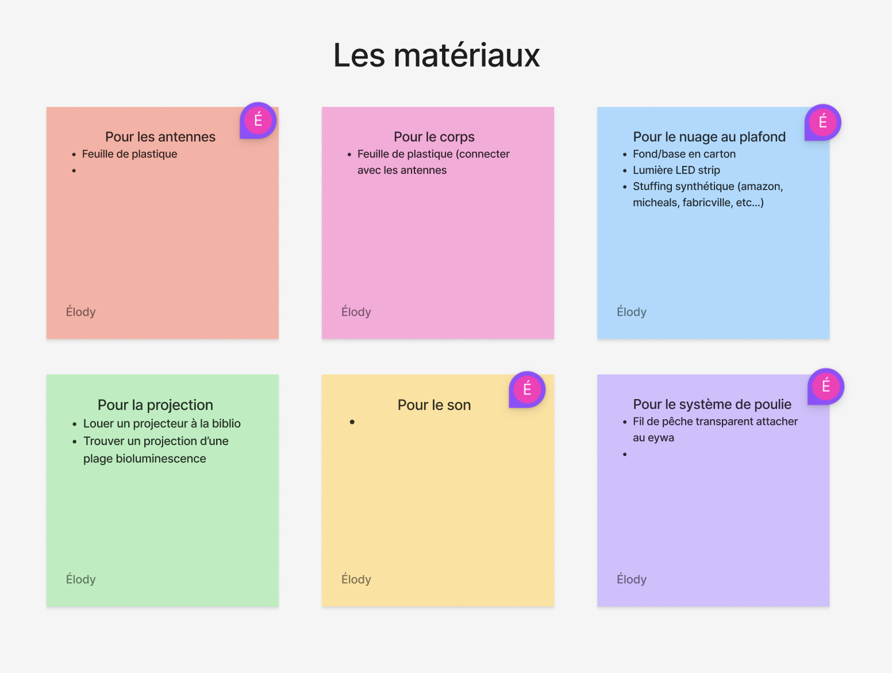
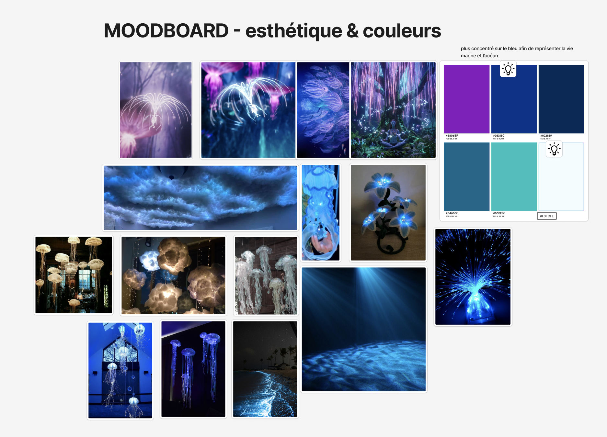
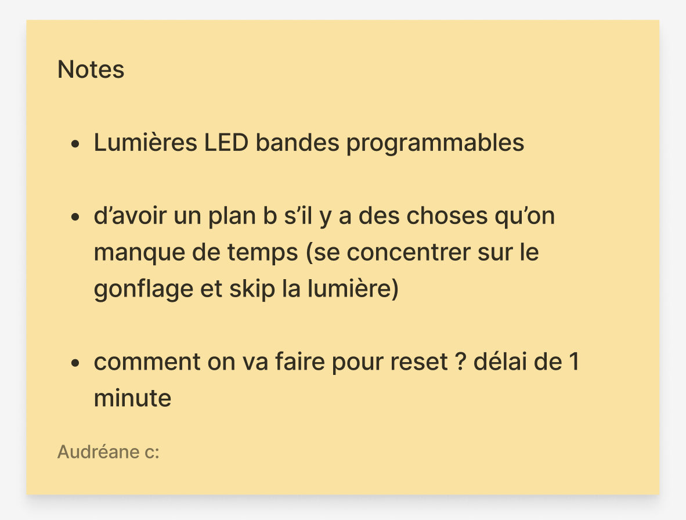
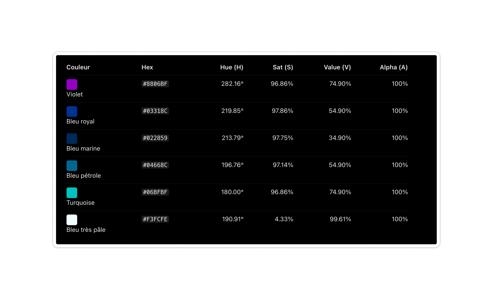
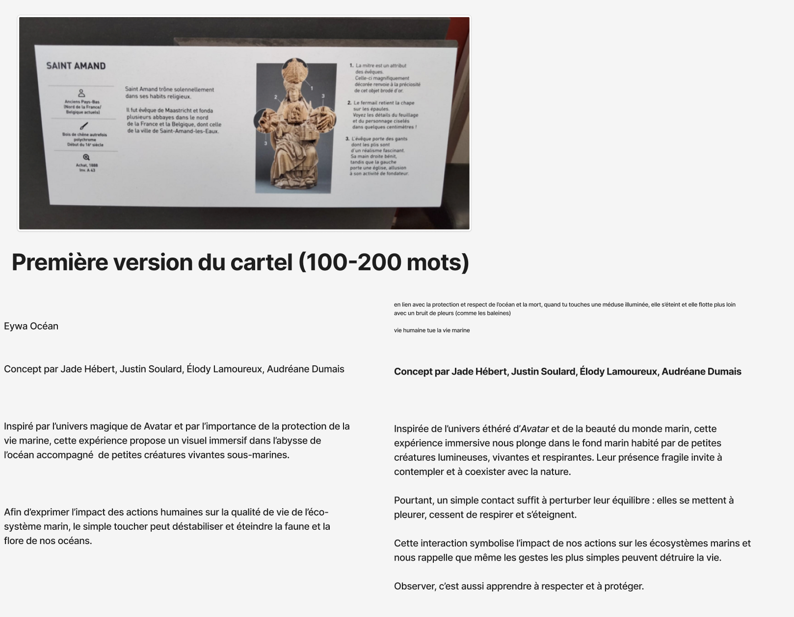
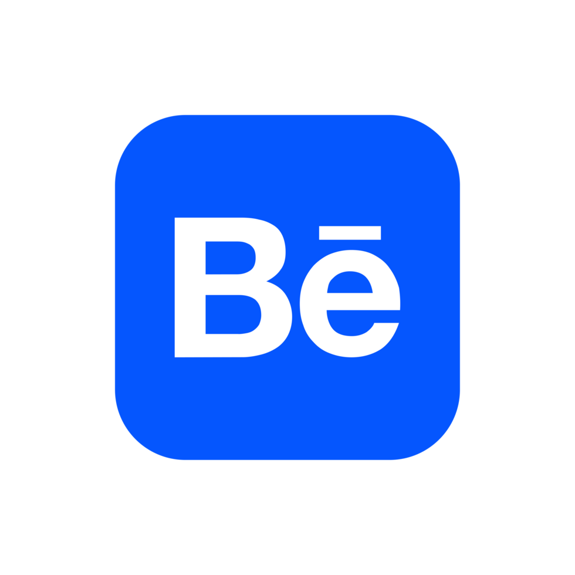

# Journal de documentation

## Sommaire

- [Objectifs](#-objectifs)
- [Échéancier](#-echeancier)
- [Entrées quotidiennes](#-entrées-quotidiennes)
- [Sources & références](#-sources--références)

## Objectifs

**Intention :** *Explorer l’univers d’Avatar en raison non seulement de son esthétique, mais aussi en raison du message profond derrière, pour une intention de conscientiser les impacts négatifs de l’activité humaine sur la nature*

**Contexte :** *Notre projet s'adresse à un public qui sont moins sensibiliser de l'impact des humains sur l'écosystème.*

**Interaction :** *Avec sa présence et ses mouvements, l’utilisateur perturbe l’environnement autour de lui, affectant les comportements et la lumière de nos  ...*

**Choix techniques et matériels :** *Notre idée de départ était de faire un contact avec les ... , pour une plus grosse sensibilisation, mais pour des contraintes de temps et de matériaux, nous avons décider d’utiliser un capteur de mouvements, qui vient aussi s’inscrire dans notre intention et ne change pas notre idée de départ.* 

*Pour le matériel, nous nous sommes inspiré de références existantes, et nous cherchions un corps qui pouvait être mou.*

[Diagramme](https://github.com/Jadoooooou/DSN230_Prototypage/blob/9cda81174c7a6ee9e832cc5a1fe44938c2f95130/projet_final/01_Diagramme.md)

## Échéancier

https://trello.com/invite/b/6aff263a9ccdf87b76820a27/ATTI7f8da8d1c0c89679886a873fa56aa5dd598670BD/dsn120

## Entrées quotidiennes

### 11-05 — *Première idéation*   

Entrée

#### Ce qui a été fait
- Analyse des mouvements et la façon dont le code et la matière interagissent
- Comprendre comment l'air circulerait dans l'œuvre
- Discussion sur l'accrochage et la disposition des fils
- Visite de la salle et de notre emplacement
- Rencontre avec le technicien pour l'exposition

#### Blocages rencontrés
- Circulation d'air: Puisque nous avons des antennes, nous nous sommes heurtés sur la manière d'assembler celles-ci avec le corps →

  *Au lieu de découper individuellement des antennes et de les reliées au corps comme idéalisé en premier lieu, nous allons prendre des plus grandes feuilles de plastique dans lesquelles nous allons détourer un patron*

#### Notes brutes

>

#### Prochaines étapes
- [ ] Finalisation du moodboard
- [ ] Trouver nos matériaux
- [ ] Avoir des grandes feuilles de plastique
- [ ] Avoir un premier code

📎 Pièces jointes & captures

 

- [Lien vers le FigJam](https://www.figma.com/board/P77ZoMvgJLPthdGSxZaMwB/DSN120_id%C3%A9ations?node-id=6-72&t=tfZSSDnDlvh2ZTZW-1)

---

### 11-11 — *Préparation et achats*   

Entrée

#### Ce qui a été fait
- Achat les matériaux (plastique et rembourage synthétique)
- Achat du mini-soudeuse
- Réservation du projecteur
- Création d'une vague virtuelle sur TouchDesigner

#### Blocages rencontrés
- Nous ne savions pas si l'école était équipée d'une plus petite thermo-soudeuse →   
  *Après une brève discussion avec les techniciens, nous avons décider de se procurer nous même une mini thermosoudeuse*

#### Notes brutes

>

#### Prochaines étapes
- [ ] Confirmer les choix / achats
- [ ] Faire un premier prototype fonctionel
      

📎 Pièces jointes & captures

---

### 11-19 — *Premiers prototypages*   

Entrée

#### Ce qui a été fait
- Présentation / décision des choix visuels et sonores
- Premiers tests du code des pompes
- Installation des circuits
- Écriture du cartel
- Création du support visuel

#### Blocages rencontrés
- Nous n'avons pas eu la chance de recevoir la mini-thermosoudeuse pour le cours →  
  *Nous avons donc souder avec la grosse commerciale disponible*
- Nous avons beaucoup de complexité pour le temps donné →    
  *Nous allons donc oublié l'idée des méduses qui montent et elles resteront suspendues, et nous allons oublié l'aspect du touché, et remplacer le tout par la détection de mouvement*
- Nous n'avons pas eu le temps de faire un prototype complet →    
  *Nous allons nous rencontrer une autre fois au courant de la semaine pour avancer dans le projet*

#### Notes brutes

>

#### Prochaines étapes
- [ ] Faire un prototype avec les bonnes dimensions
- [ ] Ajouter une lumière LED RGB à l'installation
- [ ] Ajouter une animation de la lumière et de déclenchement sonore dans le code
- [ ] Finaliser le diagramme et la présentation pour le prochain cours

📎 Pièces jointes & captures

---

## Sources & références

| # | Titre | Type  | Lien  |
|---|---|---|---|
| 1 | Inspirations |  Pinterest | [lien](https://pin.it/3Wc1fhkl2) |
| 2 | Máshol - Elsewhere project |  Benance | [lien](https://www.behance.net/gallery/51903821/Mashol-Elsewhere-project) |
| 3 | Wavy Particle Systems in TouchDesigner using POPs |  Youtube | [lien](https://youtu.be/CZe_pBAyreU) |

---

## Journal des modifications

| Date | Version | Auteur | Changement |
|---|---|---|---|
| `2026-11-05` | 0.1.0 | `Jade` | Création du journal |
| `2026-11-19` | 0.2.0 | `Justin` | Changement d'interaction |

---

*Dernière modification : `2026-11-24`*

