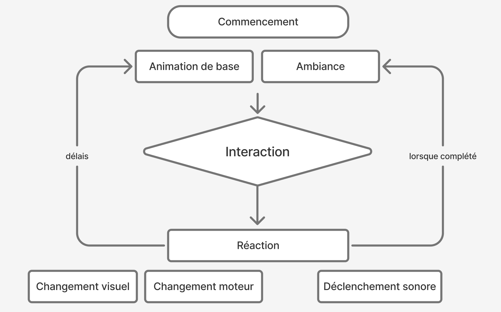

# Diagramme

**But principal :** _Explorer l’univers d’Avatar en raison non seulement de son esthétique, mais aussi en raison du message profond derrière, pour une intention de conscientiser les impacts négatifs de l’activité humaine sur la nature._

>ENTRÉE (capteur de mouvement) → TRAITEMENT (code) → SORTIE (changement visuel et moteur et déclencheur sonore)

#### Contextualisation

L’exposition vit de manière autonome. À son état initial, les créatures sont animées d’un mouvement lent et régulier évoquant la respiration, en plus d'être illuminée. Pour contribuer à créer une atmosphère vivante et contemplative, un projecteur projète une animation ressemblante à des vagues et une trame sonore évoque le sentiment de l'océan.

L'interaction est déclanchée par l'intrusion\* de visiteurs dans l'environnement de l’exposition. Leur présence est captée par une caméra qui détecte leurs mouvements.

Dès qu’un visiteur est détecté dans l’espace, une séquence de réaction s’enclenche : L'animation de lumière des créatures s’estompe doucement (_fade out_), une note sonore émis par les baleines se fait entendre, et les mouvements mécaniques des créatures ralentissent jusqu’à s’immobiliser complètement.

Après un certain délais\*, les créatures reprennent vie et l'exposition renait.

_L'intrusion était dabord le contact avec les créatures. Pour des raisons techniques et esthétiques, nous avons décider de changer l'interaction par une détection de mouvement_

_Le délais est pour l'instant une durée d'une minute, à tester_

---

_Dernière modification : `2026-11-24`_

